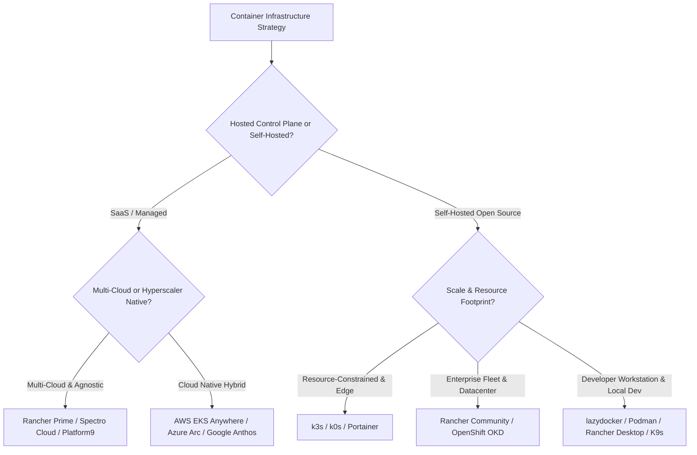

# Awesome Container Management: Top Kubernetes, Orchestration & Control Planes Ecosystem

> A curated list of leading **Container Management Platforms**, **Kubernetes Orchestration Tools**, **Multi-Cluster Control Planes**, and **Open-Source Container Software** for DevOps, Cloud Engineers, and Platform Architecture Teams.

---

## Overview

Container management platforms allow organizations to deploy, scale, operate, secure, and monitor containerized workloads across multi-cloud, on-premises, hybrid, and edge computing environments. Whether you are searching for enterprise SaaS solutions or production-grade open-source tools (Docker, Kubernetes distributions, Podman, and containerd), this guide provides an up-to-date, structured comparison.

**Key Ecosystem Areas Covered:**
- **Enterprise Kubernetes Distributions & SaaS Control Planes**
- **Multi-Cluster Orchestration & Fleet Management**
- **Open-Source Container Engines & Runtimes**
- **Terminal UIs, Dashboards, and Developer Tooling**

---

## Table of Contents

- [SaaS & Hosted Platforms](#saas--hosted-platforms)
  - [SaaS Comparison & Pricing Overview](#saas-comparison--pricing-overview)
  - [Detailed SaaS Profiles](#detailed-saas-profiles)
- [Open-Source GitHub Projects](#open-source-github-projects)
  - [Open-Source Comparison Matrix](#open-source-comparison-matrix)
  - [Leading Open-Source Projects](#leading-open-source-projects)
  - [Essential CLI Tools, TUIs & Utilities](#essential-cli-tools-tuis--utilities)
- [Selection Guide & Architectural Comparison](#selection-guide--architectural-comparison)
- [How to Contribute](#how-to-contribute)
- [Disclaimer](#disclaimer)

---

## SaaS & Hosted Platforms

Enterprise-ready hosted and managed container control planes designed for mission-critical multi-cloud and hybrid deployments.

### SaaS Comparison & Pricing Overview

| Product | Focus Area | Deployment Model | Pricing Model | Free Tier & Limits |
| :--- | :--- | :--- | :--- | :--- |
| **[Rancher Prime](https://www.rancher.com/)** | Multi-cluster Kubernetes & Day-2 Ops | SaaS / Self-Managed Enterprise | Annual subscription per node / core; custom enterprise quote | **100% Free Open-Source Core** via Community Rancher (unlimited clusters); Enterprise Rancher Prime is commercial paid only. |
| **[Red Hat OpenShift](https://www.redhat.com/en/technologies/cloud-computing/openshift)** | Enterprise Kubernetes & application platform | Managed Cloud (ROSA, ARO, OSD) or Self-managed | Core-hour or annual subscription per node; cloud pay-as-you-go | **60-day self-managed evaluation** or **30-day Developer Sandbox** (shared multi-tenant cluster, free for learning/prototyping). |
| **[VMware Tanzu Kubernetes Grid](https://www.vmware.com/products/app-platform/tanzu-kubernetes-grid)** | Enterprise K8s across vSphere & clouds | Hybrid / On-Prem / Cloud | Subscription / core licensing (bundled with VMware Cloud Foundation) | **Free evaluation / trial license**; no perpetual free tier. |
| **[Google Anthos](https://cloud.google.com/anthos)** | Hybrid & multi-cloud Kubernetes governance | Hybrid SaaS control plane | Pay-as-you-go per vCPU hour or subscription | **GCP Free Tier credits ($300)** apply for testing; no dedicated perpetual free tier. |
| **[AWS EKS Anywhere](https://anywhere.eks.amazonaws.com/)** | On-prem & bare metal Kubernetes clusters | On-Premises / Edge | Free open-source core; **$24,000/year per cluster** for enterprise support | **Free software download**; pay only if purchasing 24x7 enterprise subscription support. |
| **[Azure Arc-enabled Kubernetes](https://azure.microsoft.com/en-us/products/azure-arc)** | Multi-cluster management & Azure governance | Hybrid SaaS control plane | Basic cluster connection & inventory free; add-ons (Policy, GitOps, Monitor) pay-as-you-go | **Free control plane connection** and basic inventory; pay-as-you-go per vCPU/month for advanced configurations. |
| **[Platform9 Managed Kubernetes](https://platform9.com/)** | SaaS-managed Kubernetes control plane | SaaS Control Plane / Remote Edge | Tiered subscription per node / cluster; custom enterprise quotes | **Free Tier available** up to **3 clusters / 20 nodes** for evaluation and small workloads. |
| **[Portainer Business](https://www.portainer.io/)** | Mixed runtime management (K8s, Docker, Podman) | SaaS / Self-hosted | Per-node / annual subscription | **Free 3 Nodes ("Take 3")** license for Portainer Business; Portainer CE is 100% free and open-source. |
| **[Spectro Cloud Palette](https://www.spectrocloud.com/)** | Full-stack declarative K8s lifecycle management | SaaS / Dedicated Virtual Appliance | Tiered per-cluster / per-node usage pricing | **Free trial / Community Tier** available with limited node/cluster hours. |
| **[Mirantis Kubernetes Engine 4](https://www.mirantis.com/software/mirantis-kubernetes-engine/)** | Secure container & VM engine based on k0s | Hybrid / On-Prem / Cloud | Subscription based on node count and support SLA | **Upstream k0s is 100% free & open source**; MKE 4 enterprise includes trial period. |

---

### Detailed SaaS Profiles

- **[Rancher Prime](https://www.rancher.com/)**  
  **Enterprise Kubernetes management platform** with **multi-cluster operations across any infrastructure**. Built on a 100% open-source core with enterprise support, hardened private registry, and SLA guarantees.  
  *Features*: Centralized cluster provisioning, Day 2 automated operations (upgrades, backup, disaster recovery), centralized security RBAC, GitOps at scale (Fleet), integrated Prometheus/Grafana monitoring, and managed EKS/AKS/GKE lifecycle management.

- **[Red Hat OpenShift](https://www.redhat.com/en/technologies/cloud-computing/openshift)**  
  **Enterprise Kubernetes distribution** built on Red Hat Enterprise Linux CoreOS (RHCOS). CNCF-certified platform with comprehensive built-in security, SELinux integration, pod security standards, and HAProxy edge routing.  
  *Features*: Source-to-Image (S2I) build automation, developer console, OpenShift Virtualization (KubeVirt), integrated CI/CD (Tekton), service mesh (Istio), and Operator Lifecycle Manager (OLM).

- **[VMware Tanzu Kubernetes Grid](https://www.vmware.com/products/app-platform/tanzu-kubernetes-grid)**  
  **Enterprise-ready Kubernetes runtime** engineered for VMware Cloud Foundation and public clouds. Features automated multi-cluster operations with lifecycle management and validated ecosystem packages (networking, storage, monitoring).

- **[Google Anthos (Google Cloud Distributed Cloud)](https://cloud.google.com/anthos)**  
  **Hybrid and multi-cloud Kubernetes platform** for managing GKE clusters across AWS, Azure, and bare metal from the Google Cloud Console. Features Anthos Config Management (GitOps policy sync) and Anthos Service Mesh for consistent zero-trust security.

- **[AWS EKS Anywhere](https://anywhere.eks.amazonaws.com/)**  
  **On-premises Kubernetes deployment solution** built on Amazon EKS software. Supports bare metal (via Tinkerbell provider), VMware vSphere, and air-gapped environments, ensuring operational parity with AWS cloud EKS.

- **[Azure Arc-enabled Kubernetes](https://azure.microsoft.com/en-us/products/azure-arc)**  
  **Centralized governance and management layer** to attach CNCF-certified Kubernetes clusters (including K3s, RKE2, OpenShift, AKS-HCI) running across GCP, AWS, or on-premises to Azure Resource Manager. Supports Azure Policy, Microsoft Defender, and GitOps workflows via Flux.

- **[Platform9 Managed Kubernetes](https://platform9.com/)**  
  **SaaS-delivered Kubernetes control plane** providing zero-touch Day-2 operations, 24/7/365 Always-On monitoring, remote patching, and non-disruptive upgrades across heterogeneous infrastructure.

- **[Portainer Business](https://www.portainer.io/)**  
  **Universal container management interface** supporting Kubernetes, Docker, Docker Swarm, Podman, and Azure Container Instances (ACI). Features centralized RBAC, registry governance, template management, and audit logging.

- **[Spectro Cloud Palette](https://www.spectrocloud.com/)**  
  **Full-stack declarative Kubernetes orchestration engine** allowing custom cluster profiles spanning OS, K8s distribution, CNI, CSI, and add-on services across bare metal, public cloud, and edge appliances.

- **[Mirantis Kubernetes Engine 4](https://www.mirantis.com/software/mirantis-kubernetes-engine/)**  
  **Open-source enterprise architecture** powered by k0s CNCF-certified Kubernetes. Offers FIPS 140-2 encryption, unified container and VM orchestration via KubeVirt, and automated drift correction.

---

## Open-Source GitHub Projects

Explore the most popular, active, and community-driven open-source projects for self-hosted container orchestration, runtimes, and multi-cluster operations.

### Open-Source Comparison Matrix

| Project | License | Primary Use Case | Key Strength |
| :--- | :--- | :--- | :--- |
| **[Rancher](https://github.com/rancher/rancher)** | Apache-2.0 | Multi-cluster K8s management | Unified UI/API managing 1 to 1,000,000 clusters anywhere |
| **[OpenShift Origin (OKD)](https://github.com/openshift/origin)** | Apache-2.0 | Enterprise Kubernetes distribution | Turnkey developer platform with integrated builds & virtualization |
| **[k0s](https://github.com/k0sproject/k0s)** | Apache-2.0 | Lightweight Kubernetes distribution | Single binary, zero host dependencies, production-ready |
| **[k3s](https://github.com/k3s-io/k3s)** | Apache-2.0 | Edge, IoT, and Dev Kubernetes | Single binary (<100MB), low memory footprint, SQLite/etcd backend |
| **[Lighthouse](https://github.com/krack8/lighthouse)** | Open-source | Multi-cluster dashboard | Lightweight gRPC-based agent/controller architecture |
| **[lazydocker](https://github.com/jesseduffield/lazydocker)** | MIT | Terminal Docker/Compose dashboard | Intuitive keyboard-driven UI for local container debugging |
| **[Podman](https://github.com/containers/podman)** | Apache-2.0 | Daemonless container engine | Rootless by default, drop-in Docker CLI alias, pod support |
| **[containerd & nerdctl](https://github.com/containerd/containerd)** | Apache-2.0 | Core OCI container runtime | Industry standard core runtime; nerdctl offers modern Docker CLI parity |
| **[Rancher Desktop](https://github.com/rancher-sandbox/rancher-desktop)** | Apache-2.0 | Local container & K8s desktop environment | Open-source Docker Desktop alternative with containerd / dockerd switch |

---

### Leading Open-Source Projects

- **[Rancher](https://github.com/rancher/rancher)**  
  **The definitive open-source multi-cluster Kubernetes control plane**. Enables centralized management, cluster provisioning (via RKE, RKE2, K3s, and public cloud providers), RBAC enforcement, unified audit logs, and global application catalog deployment across any CNCF-certified infrastructure.

- **[Red Hat OpenShift Origin (OKD)](https://github.com/openshift/origin)**  
  **Upstream community distribution of Red Hat OpenShift**. Combines Kubernetes with developer workflows, built-in container registry, continuous build tools, and integrated monitoring/logging for enterprise self-hosting.

- **[k0s](https://github.com/k0sproject/k0s)**  
  **Zero-friction, single-binary Kubernetes distribution**. Has zero host OS dependencies, bundles all necessary components into an immutable binary, and operates smoothly from tiny edge gateways to large datacenter clusters.

- **[k3s](https://github.com/k3s-io/k3s)**  
  **Lightweight certified Kubernetes distribution**. Designed for resource-constrained environments, IoT, edge compute, and CI/CD testing. Replaces external dependencies with bundled SQLite/etcd, containerd, and Flannel in an ultra-compact footprint (<100 MB).

- **[Lighthouse](https://github.com/krack8/lighthouse)**  
  **Open-source multi-cluster Kubernetes dashboard**. Offers an intuitive web GUI to inspect and manage workloads across EKS, GKE, AKS, K3s, Minikube, and vanilla Kubernetes using a lightweight gRPC controller/agent design.

- **[lazydocker](https://github.com/jesseduffield/lazydocker)**  
  **Terminal UI for Docker and Docker Compose**. Delivers mouse and keyboard-driven monitoring for container stats, logs, exec shells, images, volumes, and service graphs directly inside your terminal window.

- **[Podman](https://github.com/containers/podman)**  
  **Daemonless, rootless container engine**. Built directly for OCI standards, allowing users to run containers without superuser privileges or background daemons. Features direct generation and playback of Kubernetes pod YAMLs.

- **[containerd + nerdctl](https://github.com/containerd/containerd)**  
  **Core OCI runtime and advanced CLI toolkit**. The foundational runtime powering Docker and major cloud Kubernetes platforms. Paired with `nerdctl`, it offers rootless container execution, Docker Compose support, lazy pulling (stargz), and encrypted OCI images.

- **[Rancher Desktop](https://github.com/rancher-sandbox/rancher-desktop)**  
  **Open-source cross-platform desktop container management**. Provides Kubernetes and Docker container capabilities on macOS, Windows, and Linux without commercial licensing constraints, supporting both containerd and dockerd runtimes.

---

### Essential CLI Tools, TUIs & Utilities

- **[kubectl](https://github.com/kubernetes/kubectl)** — Official Kubernetes command-line interface for running commands against clusters.
- **[Helm](https://github.com/helm/helm)** — Standard package manager for Kubernetes applications and charts.
- **[K9s](https://github.com/derailed/k9s)** — Highly popular terminal-based curses UI to navigate, observe, and manage Kubernetes clusters in real time.
- **[Lens](https://github.com/lensapp/lens)** — Standalone desktop Kubernetes IDE providing real-time metrics, cluster visualization, and log aggregation.
- **[kubectx + kubens](https://github.com/ahmetb/kubectx)** — Fast switcher utility between multiple Kubernetes contexts and namespaces.
- **[KubeVirt](https://github.com/kubevirt/kubevirt)** — Kubernetes add-on technology allowing virtual machines (VMs) to be scheduled and managed alongside container pods.

---

## Selection Guide & Architectural Comparison

When designing container infrastructure, choosing the right platform depends on organizational scale and operational constraints:

---

## How to Contribute

Contributions are welcome! To contribute a project, tool, or update:

1. **Fork** the repository.
2. **Create a branch**: `git checkout -b feature/add-new-container-tool`.
3. **Add or update** entries in [README.md](file:///C:/Users/ishan/Documents/Projects/Awesome-Container-Management/README.md) following the existing Markdown format and tabular structure.
4. If submitting a SaaS product, make sure to include pricing details and free tier limits.
5. **Open a Pull Request** with a concise description of why the tool is valuable to the community.

---

## Disclaimer

- This list is community-curated for informational, architectural, and educational purposes.
- Always review production security standards (CIS benchmarks, zero-trust network policies, RBAC isolation, and compliance regulations) before deploying container runtimes in production.
- All product names, logos, and brands are property of their respective owners.

---

  Maintained for platform engineers, DevOps practitioners, and cloud architects worldwide.

