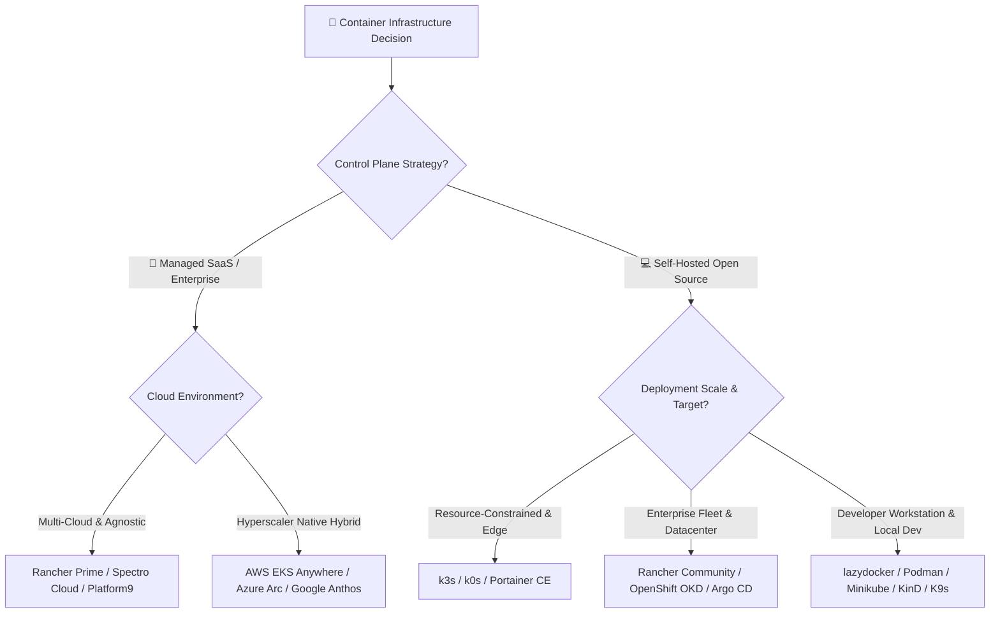

  

# 🚀 Awesome Container Management: Top Kubernetes, Orchestration & Control Planes Ecosystem

  
  
  
  
  
  

> 🌐 A comprehensive, production-grade curated list of leading **Container Management Platforms**, **Kubernetes Orchestration Suites**, **Multi-Cluster Control Planes**, and **Open-Source Container Software** for DevOps teams, Site Reliability Engineers (SREs), and Cloud Platform Architects.

---

## 📑 Table of Contents

- [🔍 Sector Overview & Market Dynamics](#-sector-overview--market-dynamics)
- [🏢 SaaS & Hosted Enterprise Platforms](#-saas--hosted-enterprise-platforms)
  - [SaaS Solutions Comparison & Pricing Table](#saas-solutions-comparison--pricing-table)
  - [Detailed SaaS Profiles](#detailed-saas-profiles)
- [💻 Open-Source GitHub Projects](#-open-source-github-projects)
  - [Leading Open-Source Repositories (Ranked by Stars)](#leading-open-source-repositories-ranked-by-stars)
  - [Essential CLI Tools, TUIs & Utilities](#essential-cli-tools-tuis--utilities)
- [📐 Architectural Decision Flowchart](#-architectural-decision-flowchart)
- [🤝 How to Contribute](#-how-to-contribute)
- [💖 Support & Sponsorship](#-support--sponsorship)
- [⭐ Star History](#-star-history)
- [📜 Disclaimer](#-disclaimer)

---

## 🔍 Sector Overview & Market Dynamics

The global container management and containerization software market is estimated at **$11.05 billion in 2026** and projected to surpass **$24 billion by 2031**, expanding at a Compound Annual Growth Rate (CAGR) of approximately **17%**. 

The sector displays a **moderately concentrated core with a highly fragmented surrounding tooling ecosystem**: the foundational orchestration and control plane tier is dominated by hyperscale cloud platforms (Microsoft Azure, AWS, Google Cloud) and established enterprise software vendors (Red Hat / IBM, SUSE, Broadcom), while the surrounding lifecycle layers—such as edge orchestrators, terminal developer consoles, niche security tools, and multi-cloud dashboards—remain intensely fragmented and driven by fast-paced open-source innovation.

---

## 🏢 SaaS & Hosted Enterprise Platforms

### SaaS Solutions Comparison & Pricing Table

The table below catalogs leading commercial and managed container platforms, sorted by parent company scale (revenue / market valuation, descending).

| 🏢 Product | 🌐 Focus Area | 💰 Company Scale (Revenue / Valuation) | 🏷️ Specific Starting Pricing | 🎁 Free Tier / Free Trial Limits |
| :--- | :--- | :--- | :--- | :--- |
| **[Azure Arc-enabled Kubernetes](https://azure.microsoft.com/en-us/products/azure-arc)** | Hybrid & multi-cloud Kubernetes governance & GitOps | **~$3.1 Trillion Market Cap** (Microsoft parent) | **$0.00 base control plane connection**; advanced configurations (e.g. Arc Data Services) start at **$0.137 per vCore/hour** | **Perpetual Free Tier**: Free connection, inventory, tagging, and basic Azure Policy enforcement for unlimited CNCF-certified clusters. |
| **[Google Anthos](https://cloud.google.com/anthos)** | Multi-cloud container control plane & service mesh | **~$2.1 Trillion Market Cap** (Alphabet parent) | **$0.10 per cluster/hour** management fee plus pay-as-you-go infrastructure or **$40/month per vCPU** subscription | **90-day Free Trial with $300 GCP credits**; includes Anthos sandbox testing environment with quotas. |
| **[AWS EKS Anywhere](https://anywhere.eks.amazonaws.com/)** | On-prem bare metal & vSphere Kubernetes deployments | **~$2.0 Trillion Market Cap** (Amazon parent) | **$0.00 base open-source binaries**; official 24/7 enterprise support package starts at **$24,000/year per cluster** | **Perpetual Free Software**: Base open-source EKS Anywhere distribution and tooling can be deployed for free on your own hardware without time or node limits. |
| **[Red Hat OpenShift](https://www.redhat.com/en/technologies/cloud-computing/openshift)** | Full-stack enterprise application & K8s platform | **~$150+ Billion Market Cap** (IBM parent) | **$0.076 per 4 vCPU/hour** (3-year managed cloud commitment) or **$0.171/hour on-demand**; self-managed starts at **~$10,000/year per socket-pair** | **30-day Developer Sandbox** (free multi-tenant cluster with 4 vCPUs / 16GB RAM) or **60-day self-managed evaluation trial** for full-stack clusters. |
| **[VMware Tanzu Kubernetes Grid](https://www.vmware.com/products/app-platform/tanzu-kubernetes-grid)** | Enterprise K8s across vSphere & hybrid cloud | **~$140+ Billion Market Cap** (Broadcom parent) | Included in VMware Cloud Foundation subscriptions starting at **~$350 per core/year** | **60-day Free Evaluation Trial** with standard vSphere & Tanzu management cluster licenses. |
| **[Rancher Prime](https://www.rancher.com/)** | Unified multi-cluster Kubernetes management & Day-2 ops | **~$4 Billion - $6 Billion Valuation** (SUSE parent, ~$800M annual revenue) | Starts at **~$450 per node/month** (~$5,400/year) for standard cloud marketplace tiers; volume enterprise discounts scale to **~$100–$250/node/month** | **Perpetual Free Open-Source Core** via Community Rancher (unlimited clusters & nodes forever); Rancher Prime offers **30-day enterprise evaluation trial**. |
| **[Spectro Cloud Palette](https://www.spectrocloud.com/)** | Declarative full-stack K8s lifecycle & edge management | **~$1 Billion Valuation** (Unicorn, $260M total raised) | Starts at **~$0.04 per node/hour** (~$29/month per worker node) on public cloud marketplaces or flat device fees for edge | **30-day Free Trial with 5,000 free cluster-hours** and full access to Palette dashboard, packs, and PaletteAI features. |
| **[Mirantis Kubernetes Engine 4](https://www.mirantis.com/software/mirantis-kubernetes-engine/)** | Enterprise container and VM engine powered by k0s | **~$625 Million Valuation** (Acquired by IREN, $100M+ ARR) | Starts at **~$2,500 per node/year** including production enterprise support and FIPS security compliance | **Perpetual Free Core** via open-source upstream k0s; commercial MKE 4 includes a **30-day full-feature trial license**. |
| **[Platform9 Managed Kubernetes](https://platform9.com/)** | SaaS-managed Kubernetes control plane with 24/7 SLA | **~$150 Million - $250 Million Valuation** ($100M venture funding) | Starts at **$250 per core/year** enterprise subscription or **$1,000/month platform fee** for dedicated private cloud entry | **Perpetual Free Community Edition**: Supports up to **3 clusters and 20 worker nodes** with zero time limits and free community forum support. |
| **[Portainer Business](https://www.portainer.io/)** | Operator control plane for K8s, Docker, and Podman | **~$15 Million - $30 Million Valuation** ($7.2M venture funding, ~$4.7M ARR) | **$1,045/year** for Starter Plan (up to 5 nodes, max 16 vCPUs/node) or **$2,095/year** for Scale Plan (up to 5 nodes, max 24 vCPUs/node) | **Perpetual Free Tier ("Take 3")**: Free Portainer Business license for up to **3 nodes forever**; Portainer Community Edition (CE) is 100% free and open source. |

---

### Detailed SaaS Profiles

- **[Azure Arc-enabled Kubernetes](https://azure.microsoft.com/en-us/products/azure-arc)**  
  ☁️ **Centralized governance and management layer** to attach CNCF-certified Kubernetes clusters (including K3s, RKE2, OpenShift, AKS-HCI) running across GCP, AWS, or on-premises to Azure Resource Manager. Supports Azure Policy, Microsoft Defender, and GitOps workflows via Flux.

- **[Google Anthos (Google Cloud Distributed Cloud)](https://cloud.google.com/anthos)**  
  🌐 **Hybrid and multi-cloud Kubernetes platform** for managing GKE clusters across AWS, Azure, and bare metal from the Google Cloud Console. Features Anthos Config Management (GitOps policy sync) and Anthos Service Mesh for consistent zero-trust security.

- **[AWS EKS Anywhere](https://anywhere.eks.amazonaws.com/)**  
  📦 **On-premises Kubernetes deployment solution** built on Amazon EKS software. Supports bare metal (via Tinkerbell provider), VMware vSphere, and air-gapped environments, ensuring operational parity with AWS cloud EKS.

- **[Red Hat OpenShift](https://www.redhat.com/en/technologies/cloud-computing/openshift)**  
  🎩 **Enterprise Kubernetes distribution** built on Red Hat Enterprise Linux CoreOS (RHCOS). CNCF-certified platform with comprehensive built-in security, SELinux integration, pod security standards, and HAProxy edge routing. Features Source-to-Image (S2I), OpenShift Virtualization, and Tekton CI/CD pipelines.

- **[VMware Tanzu Kubernetes Grid](https://www.vmware.com/products/app-platform/tanzu-kubernetes-grid)**  
  🧱 **Enterprise-ready Kubernetes runtime** engineered for VMware Cloud Foundation and public clouds. Features automated multi-cluster operations with lifecycle management and validated ecosystem packages.

- **[Rancher Prime](https://www.rancher.com/)**  
  🤠 **Enterprise Kubernetes management platform** with **multi-cluster operations across any infrastructure**. Built on a 100% open-source core with enterprise support, hardened private registry, and SLA guarantees. Centralized cluster provisioning, Day 2 automated operations, and Fleet GitOps.

- **[Spectro Cloud Palette](https://www.spectrocloud.com/)**  
  🎨 **Full-stack declarative Kubernetes orchestration engine** allowing custom cluster profiles spanning OS, K8s distribution, CNI, CSI, and add-on services across bare metal, public cloud, and edge appliances.

- **[Mirantis Kubernetes Engine 4](https://www.mirantis.com/software/mirantis-kubernetes-engine/)**  
  🛡️ **Open-source enterprise architecture** powered by k0s CNCF-certified Kubernetes. Offers FIPS 140-2 encryption, unified container and VM orchestration via KubeVirt, and automated drift correction.

- **[Platform9 Managed Kubernetes](https://platform9.com/)**  
  ⚡ **SaaS-delivered Kubernetes control plane** providing zero-touch Day-2 operations, 24/7/365 Always-On monitoring, remote patching, and non-disruptive upgrades across heterogeneous infrastructure.

- **[Portainer Business](https://www.portainer.io/)**  
  🚢 **Universal container management interface** supporting Kubernetes, Docker, Docker Swarm, Podman, and Azure Container Instances (ACI). Features centralized RBAC, registry governance, template management, and audit logging.

---

## 💻 Open-Source GitHub Projects

### Leading Open-Source Repositories (Ranked by Stars)

Below is the ranked leaderboard of top open-source projects for container runtime, Kubernetes distribution, and multi-cluster control planes, sorted strictly by GitHub_Stars in descending order.

| 🏆 Project | ⭐ GitHub_Stars | ⚖️ License | 🎯 Primary Category & Purpose |
| :--- | :--- | :--- | :--- |
| **[Moby / Docker Engine](https://github.com/moby/moby)** |  | Apache-2.0 | 🐳 Core open-source container framework and Docker backend engine |
| **[lazydocker](https://github.com/jesseduffield/lazydocker)** |  | MIT | 🖥️ Terminal UI dashboard for monitoring and managing Docker & Compose |
| **[Portainer Community Edition](https://github.com/portainer/portainer)** |  | zlib | 🚢 Universal web UI control plane for Docker, Swarm, Podman & Kubernetes |
| **[K9s](https://github.com/derailed/k9s)** |  | Apache-2.0 | ⌨️ Real-time curses-based terminal UI to manage Kubernetes clusters |
| **[k3s](https://github.com/k3s-io/k3s)** |  | Apache-2.0 | 🪶 Lightweight certified Kubernetes distribution (<100MB) for Edge & IoT |
| **[Podman](https://github.com/containers/podman)** |  | Apache-2.0 | 🦭 Daemonless, rootless container engine for developing & running OCI containers |
| **[Minikube](https://github.com/kubernetes/minikube)** |  | Apache-2.0 | 🧪 Local Kubernetes cluster engine tailored for testing and development |
| **[Helm](https://github.com/helm/helm)** |  | Apache-2.0 | ⎈ Standard package and chart manager for Kubernetes deployments |
| **[Rancher](https://github.com/rancher/rancher)** |  | Apache-2.0 | 🤠 100% open-source multi-cluster Kubernetes orchestration control plane |
| **[Argo CD](https://github.com/argoproj/argo-cd)** |  | Apache-2.0 | 🐙 Declarative, GitOps continuous delivery tool for multi-cluster Kubernetes |
| **[Lens](https://github.com/lensapp/lens)** |  | MIT (Core) | 🔭 The desktop IDE for Kubernetes developers and operators |
| **[containerd](https://github.com/containerd/containerd)** |  | Apache-2.0 | ⚙️ Industry-standard core container runtime used by Docker & Kubernetes |
| **[kubectx + kubens](https://github.com/ahmetb/kubectx)** |  | Apache-2.0 | 🔀 Fast terminal switcher between Kubernetes cluster contexts and namespaces |
| **[KinD (Kubernetes in Docker)](https://github.com/kubernetes-sigs/kind)** |  | Apache-2.0 | 📦 Tool for running local Kubernetes clusters using Docker container "nodes" |
| **[Red Hat OpenShift OKD](https://github.com/openshift/origin)** |  | Apache-2.0 | 🛡️ The community distribution of Red Hat OpenShift platform |
| **[Rancher Desktop](https://github.com/rancher-sandbox/rancher-desktop)** |  | Apache-2.0 | 💻 Cross-platform desktop container management and local Kubernetes runtime |
| **[KubeVirt](https://github.com/kubevirt/kubevirt)** |  | Apache-2.0 | 🖥️ Cloud-native virtualization technology to run VMs alongside container pods |
| **[k0s](https://github.com/k0sproject/k0s)** |  | Apache-2.0 | 🏎️ Frictionless, single-binary Kubernetes distribution with zero dependencies |
| **[kubectl](https://github.com/kubernetes/kubectl)** |  | Apache-2.0 | 🕹️ Official Kubernetes command-line interface tool |
| **[Lighthouse](https://github.com/krack8/lighthouse)** |  | Open-source | 💡 Lightweight multi-cluster web dashboard using gRPC agent-controller |

---

### Essential CLI Tools, TUIs & Utilities

- 🕹️ **[kubectl](https://github.com/kubernetes/kubectl)** — Universal command-line interface for communicating with cluster API servers.
- ⎈ **[Helm](https://github.com/helm/helm)** — Standard package manager for templating and rolling out Kubernetes charts.
- ⌨️ **[K9s](https://github.com/derailed/k9s)** — Highly responsive curses terminal UI for real-time observability and container operations.
- 🔭 **[Lens](https://github.com/lensapp/lens)** — Visual IDE for cluster introspection, workload log streaming, and metric graphs.
- 🔀 **[kubectx + kubens](https://github.com/ahmetb/kubectx)** — Fast context and namespace switching utilities for multi-cluster operators.
- 🖥️ **[KubeVirt](https://github.com/kubevirt/kubevirt)** — CNCF incubating project providing VM orchestration on Kubernetes.
- 🐙 **[Argo CD](https://github.com/argoproj/argo-cd)** — Declarative GitOps deployment engine for cluster fleet configuration sync.

---

## 📐 Architectural Decision Flowchart

---

## 🤝 How to Contribute

Contributions are warmly welcomed! Help us keep this container management index fresh, accurate, and valuable:

1. 🍴 **Fork** the repository.
2. 🌿 **Create a feature branch**: `git checkout -b feature/add-new-tool`.
3. 📝 **Add or update** entries in [README.md](file:///C:/Users/ishan/Documents/Projects/Awesome-Container-Management/README.md) following the established table structure and emoji styling.
4. 💡 For SaaS additions, provide verified starting prices, parent valuation/revenue, and exact free tier/trial limits.
5. ⭐ For open-source additions, include the official repository link, license, and social Stars_Badge.
6. 🚀 **Submit a Pull Request** with a summary of the added tool.

---

## 💖 Support & Sponsorship

If you find this curated ecosystem directory helpful in your platform architecture work, cloud migrations, or DevOps daily routine, please consider supporting the project:

- ⭐ **Star this repository** to help other engineers discover it.
- 🍴 **Fork and share** it with your developer community and platform teams.
- ☕ **Buy me a coffee & sponsor ongoing research:**  
    
  *Support development on the [GitHub Sponsors Dashboard](https://github.com/sponsors/ishandutta2007).*

Thank you for being part of the cloud-native open-source community! ❤️

---

## ⭐ Star History

---

## 📜 Disclaimer

- 📌 This list is community-curated for informational, architectural, and educational purposes.
- 🛡️ Always enforce security best practices (CIS Kubernetes benchmarks, zero-trust network policies, RBAC isolation, and compliance frameworks) prior to hosting containerized workloads in production.
- 🏷️ All trademarks, logos, and brand names are the property of their respective owners.

---

  Maintained with ❤️ for platform engineers, DevOps practitioners, and cloud architects worldwide.

# Awesome-Container-Management

